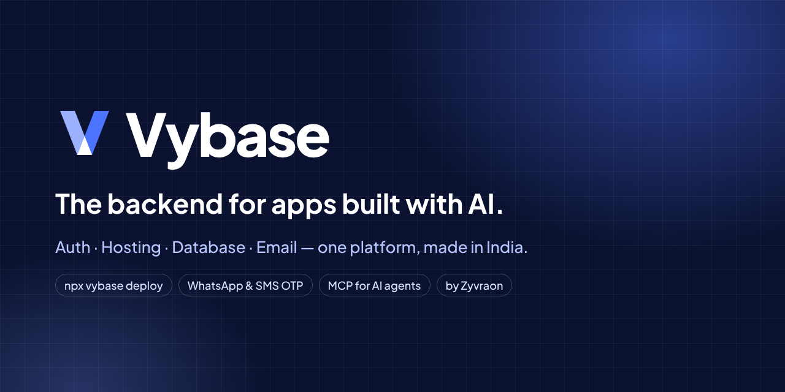

<p align="center">
  
</p>

**Vybase** is the backend for apps built with AI: sign-in, hosting, database and email in one place, with SDKs, a CLI and an MCP server, so your AI coding tool can set it up for you.

- **Auth**: email and password, email codes, WhatsApp and SMS OTP, Google with zero setup, and "Continue with Zyvraon"
- **Hosting**: deploy from GitHub or with `npx vybase deploy`, preview links for every branch and pull request, instant rollback, your own domain with HTTPS
- **Made for AI builders**: one prompt or one MCP connection and your agent wires everything up
- Database, file storage, functions and email are coming next

### Start

```bash
npm i @vybase/js          # JavaScript / TypeScript
flutter pub add vybase    # Flutter
pip install vybase        # Python
npx vybase deploy         # put a site live
```

**Console:** https://console.zyvraone.site · **Docs for AI tools:** https://auth.zyvraone.site/llms.txt

| Repository | What |
| --- | --- |
| [vybase-js](https://github.com/vybase/vybase-js) | JavaScript / TypeScript SDK |
| [vybase-flutter](https://github.com/vybase/vybase-flutter) | Flutter SDK |
| [vybase-python](https://github.com/vybase/vybase-python) | Python SDK |
| [cli](https://github.com/vybase/cli) | `vybase` command line: deploy, projects, keys |
| [mcp](https://github.com/vybase/mcp) | MCP server for AI coding agents |

Built in India by [Zyvraon Terminals Pvt Ltd](https://api.zyvraone.site).
